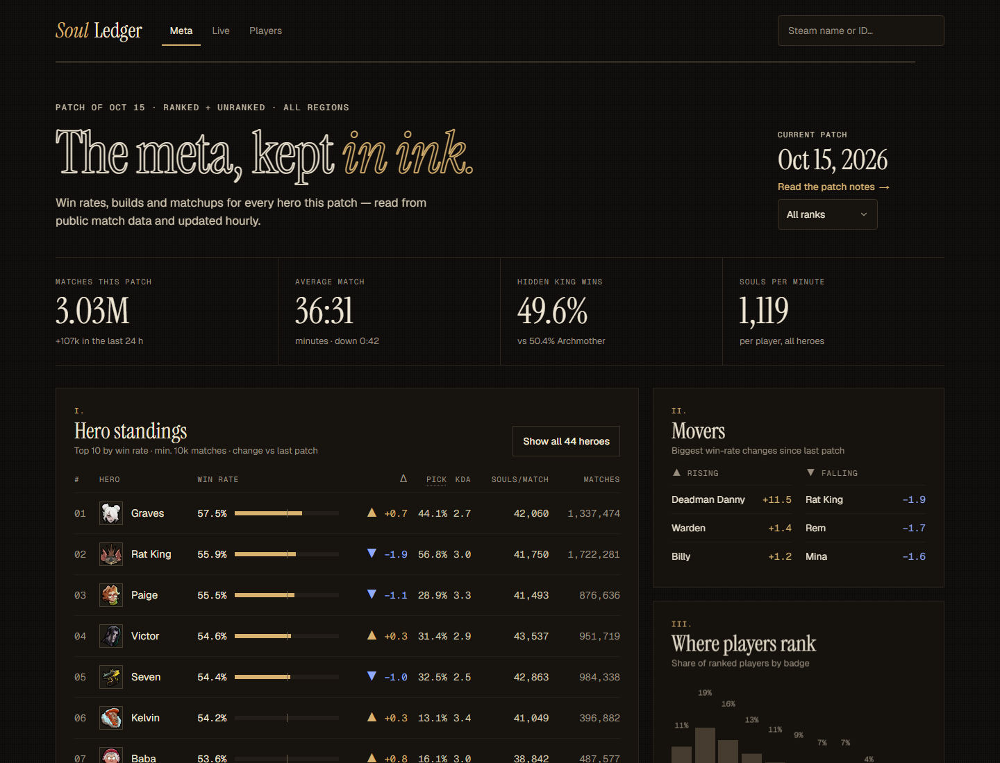

# Soul Ledger

**A stats site for Valve's _Deadlock_: the hero and item meta, live matches,
match reports and player profiles.**



- **Meta** (`/`): hero win rates and pick rates for the current patch, the
  biggest movers since last patch, where players rank, the items that win, and
  who beats whom. Filter by rank.
- **Live** (`/live`): matches in progress, with souls, leads and lineups,
  refreshed every 30 seconds.
- **Match report** (`/matches/[id]`): souls lead over time, scoreboard, damage
  share, objectives and each player's build order.
- **Player profile** (`/players/[id]`): rank climb, last 20 games, hero pool,
  teammates and match history. Search by Steam name, ID or profile link at
  `/players`.

Data via **[deadlock-api.com](https://deadlock-api.com)**, the free community
Deadlock API.

> **Fan project, not affiliated with Valve.** Soul Ledger is non-commercial and
> is not affiliated with or endorsed by Valve Corporation. _Deadlock_ and its
> art are trademarks and property of Valve.

## Stack

- **Next.js 16** (App Router, Cache Components) + **React 19** + **TypeScript**
- **Tailwind CSS v4**, with **shadcn/ui** (Radix) for tabs, select and tooltip
- **zod**: every API response is validated at the server boundary
- **SWR**: client polling on the Live page only
- **Motion** for animation (GSAP only inside the ink-drawn page titles)
- Hand-built SVG charts, with no chart library
- **lucide-react** icons

All calls to the Deadlock API happen on the server and are cached with
`"use cache"` profiles (24 h for assets, 1 h for analytics, 7 days for finished
matches, 5 min for players and 30 s for live), so page views don't hit the API
directly. See [docs/ARCHITECTURE.md](docs/ARCHITECTURE.md) for the full
walkthrough.

## Running locally

Requires Node.js 20+.

```powershell
npm install
npm run dev        # http://localhost:3000
```

| Command | What it does |
|---|---|
| `npm run dev` | Development server |
| `npm run lint` | ESLint |
| `npm run build` | Production build |
| `npm run start` | Serve the production build |

### Environment variables (all optional)

| Variable | Purpose |
|---|---|
| `DEADLOCK_API_KEY` | Sent as `X-API-KEY` to deadlock-api.com for higher rate limits |
| `DATA_SOURCE=fixtures` | Read saved API responses from `src/data/fixtures/` instead of the live API (offline development). A "Sample data" badge is shown while this is on. **Leave it unset in production.** |

## Deploying to Vercel

Import the repository into Vercel. It's a standard Next.js project, so no extra
configuration is needed. Leave `DATA_SOURCE` unset so the site uses live data.

Hero icons, item art and Steam avatars are already small images, so they are
served without Vercel image optimisation (`unoptimized`) to stay within the free
plan's image transformations. Rank badges are larger files shown at 20 px, so
they stay optimised; there are only about 80 of them.

## Credits

- Data: [deadlock-api.com](https://deadlock-api.com)
- `StrokeText` and `ShapeWaves` adapted from [React Bits](https://github.com/DavidHDev/react-bits)
